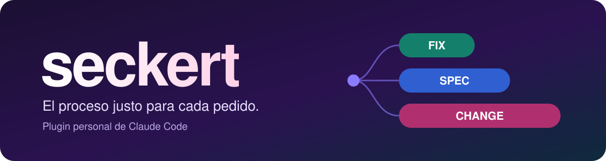
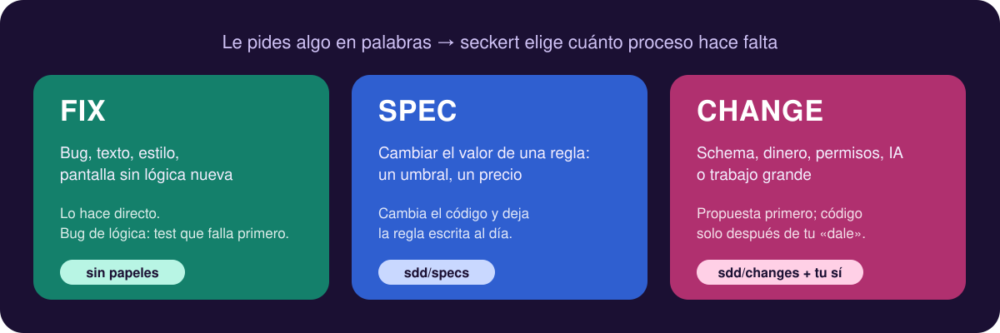
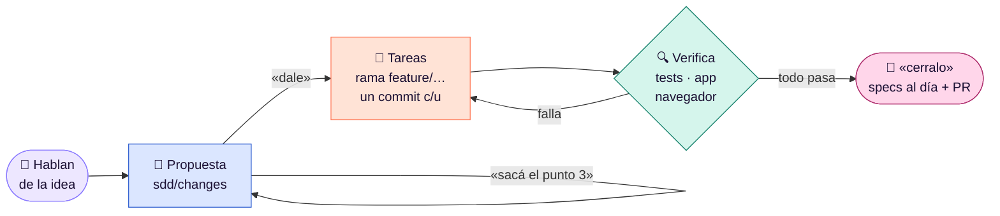

<p align="center">
  
</p>

<p align="center">
  
  
  
</p>

<p align="center">
  Le hablas a Claude como siempre y <b>seckert decide cuánto proceso hace falta</b>.<br>
  Lo chico se hace directo. Lo grande o sensible pasa antes por una propuesta que apruebas tú.
</p>

<p align="center">
  <a href="#-instalación">Instalación</a> ·
  <a href="#-se-usa-hablando">Cómo se usa</a> ·
  <a href="docs/README.md">Documentación completa</a>
</p>

---

## 🎛️ Tres rutas, una sola conversación

<p align="center">
  
</p>

Ante la duda, Claude elige **FIX**. Si el trabajo crece a más de ~8 archivos, para y te propone un **CHANGE**.

## 🔁 La vida de un cambio grande



Hasta tu «dale» no se toca código. Si el mismo punto falla **tres veces**, Claude deja de insistir y te propone cambiar el enfoque. → [Verificación y PR](docs/verificacion.md)

## 🛡️ Siempre activo

| | |
|---|---|
| 🔒 **Ramas protegidas** | Un hook bloquea `commit` y `push` directos a `main`, `develop` y `staging`. Si pides commitear ahí, Claude abre una rama `fix/…`. |
| ✋ **Nada sin pedirlo** | Ni push, ni PR, ni merge, ni releases si no se lo pides. |
| 🧠 **Memoria de sesión** | Al abrir Claude Code, seckert le recuerda las reglas, el flujo de ramas del repo y los cambios que quedaron abiertos. |
| 🎨 **Diseño en artifacts** | seckert no dibuja diseño: lo enlaza desde un artifact de Claude y lo traduce a tu código. |

## 📦 Instalación

Necesitas Claude Code actualizado y acceso al repo privado [`abelcondev/seckert`](https://github.com/abelcondev/seckert). Es privado: solo entra quien tenga acceso al repo.

**Lo más fácil:** abre Claude Code en cualquier carpeta y pega esto.

```text
Instalá el plugin seckert en mi Claude Code:

1. Comprobá que tengo acceso al repo privado abelcondev/seckert con `git ls-remote https://github.com/abelcondev/seckert HEAD`. Si falla, explicame cómo darle acceso a git (por ejemplo con `gh auth login`) y pará ahí.
2. Agregá el marketplace con `claude plugin marketplace add abelcondev/seckert`. Si ya existe, actualizalo con `claude plugin marketplace update seckert`.
3. Instalá el plugin con `claude plugin install seckert@seckert`. Si ya estaba instalado, actualizalo con `claude plugin update seckert@seckert`.
4. Al final decime en dos líneas qué versión quedó instalada y que reinicie Claude Code para que cargue.
```

<details>
<summary><b>A mano, o para actualizar</b></summary>

```sh
# instalar
claude plugin marketplace add abelcondev/seckert
claude plugin install seckert@seckert

# actualizar (los dos pasos)
claude plugin marketplace update seckert
claude plugin update seckert@seckert
```

Después reinicia Claude Code. Más detalle (scopes por proyecto, cómo comprobar la versión): [docs/instalacion.md](docs/instalacion.md).

</details>

## 💬 Se usa hablando

No hace falta escribir comandos.

| Dices algo como… | Claude… |
|---|---|
| "Cambiá el texto del botón de pagar" | lo cambia y te lo cuenta en dos líneas |
| "Agregá exportación CSV de pedidos" | escribe la propuesta y espera tu "sí" |
| "Implementá esto: https://claude.ai/artifact/…" | traduce el diseño con tus componentes y tokens |
| "dale" · "seguí" · "hacé la T3" | aprueba y avanza tarea por tarea |
| "¿funciona?" · "verificá" | comprueba cada punto, también en el navegador |
| "cerralo, abrí el PR" | actualiza las specs y abre el PR |
| "tomá el issue 12" | crea la rama enlazada al issue y sigue su ruta |
| "se rompió X en producción" | hotfix con un test que reproduce el fallo |
| "¿en qué estamos?" | resumen de lo que queda abierto |

<sub>Si prefieres comandos: `/seckert:change` `/seckert:design` `/seckert:next` `/seckert:verify` `/seckert:done` `/seckert:hotfix` `/seckert:tomar` `/seckert:release` `/seckert:status`.</sub>

## 📊 ¿Sirve?

17 pedidos reales, 5 corridas con seckert y 5 sin seckert, mismo modelo:

| | Con seckert | Sin seckert |
|---|:---:|:---:|
| Sigue el flujo (propuesta, ramas, tests, PR) | **84/85** | 37/85 |
| Lo chico sigue siendo directo | **30/30** | 30/30 |
| Palabras por respuesta | **127** | 189 |

→ [Benchmark completo](docs/benchmark.md)

## 📚 Para saber más

| | |
|---|---|
| 🗺️ [Flujo de trabajo](docs/flujo.md) | Rutas, cómo se planifica una feature y qué archivos crea |
| ✅ [Verificación y PR](docs/verificacion.md) | Rondas de verificación, QA en el navegador y qué trae el PR |
| ⚙️ [Configuración del proyecto](docs/configuracion.md) | Ramas, nivel de tests, AGENTS.md y la barra de estado |
| 📊 [Benchmark](docs/benchmark.md) | Con seckert vs. sin seckert, caso por caso |
| 🛠️ [Desarrollo del plugin](docs/desarrollo.md) | Para quien modifica seckert |
