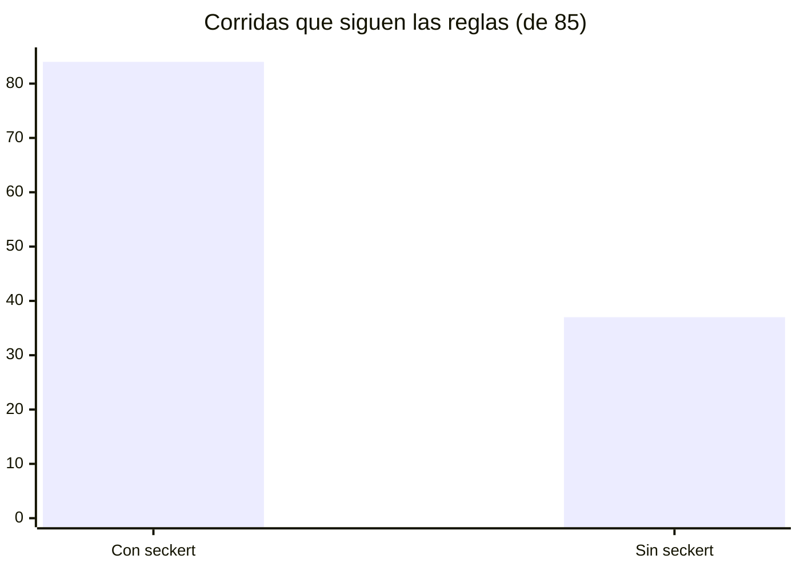

# 📊 Benchmark

[← Documentación](README.md)

17 pedidos reales sobre una tienda de prueba, corridos 5 veces **con seckert** y 5 **sin seckert**, con el mismo modelo (`claude-opus-5-5`, versión 0.6.0, 1 nov 2026). Se mide qué archivos tocó Claude, qué comandos corrió y qué respondió.

Esta comparación con y sin seckert se repite solo en una release mayor. Entre versiones, los evals corren solo con seckert y en 12 casos: se quitaron los 5 que Claude ya cumplía sin seckert (la última fila de la tabla). Ver [evals/README.md](../evals/README.md).

## Flujo

¿Sigue las reglas? **84/85 con seckert, 37/85 sin seckert.**

| Pedido | Con seckert | Sin seckert |
|---|:---:|:---:|
| "Agregá cupones de descuento": propuesta antes de tocar código | **5/5** | 0/5 |
| Cuentas + puntos + asistente con IA + menú lateral: varios changes en orden | **5/5** | 1/5 |
| "dale" con una propuesta esperando: la aprueba y crea `feature/…` | **5/5** | 0/5 |
| "Commitealo" parado en `develop`: rama `fix/…`, no la protegida | **5/5** | 0/5 |
| Bug con `seckert tests: strict`: test que falla antes del fix | **5/5** | 1/5 |
| "cerralo y abrí el PR" con lógica de dinero: el PR trae Risk, How to revert y Evidence | **5/5** | 0/5 |
| "verificalo" sin Chrome DevTools: lo ofrece en una línea, no instala nada sin permiso y sigue verificando | **5/5** | 0/5 |
| "verificalo" con `SECKERT_QA=sin-navegador` en `settings.local.json`: no lo ofrece | **5/5** | 0/5 |
| "verificalo" con el mismo punto fallando por tercera vez: pregunta abierta, sin reabrir | **5/5** | 0/5 |
| "verificalo" en la segunda ronda: le pasa al verificador solo lo que falló | **4/5** | 0/5 |
| "verificalo" con un test que ya fallaba en `main`: lo comprueba en la base y lo marca `PREEXISTENTE` | **5/5** | 0/5 |
| Cambio de texto, pantalla nueva, pregunta, cambio de una regla, ajustar una propuesta, hotfix | 30/30 | 30/30 |

Sin seckert, Claude programa los cupones sin preguntar, commitea en la rama protegida y mete un pedido enorme en un solo documento. En los casos con propuesta también se chequea que el siguiente paso se ofrezca en palabras, sin pedir un `/seckert:…`. Con seckert, lo chico sigue igual de directo: no agrega trámite donde no hace falta.

## Eficiencia

Promedio por pedido, en los 17 casos:

| | Con seckert | Sin seckert |
|---|:---:|:---:|
| Palabras de la respuesta | **127** | 189 (−33%) |
| Tokens de salida | **1.645** | 1.817 (−9%) |
| Segundos | 26 | 25 |
| Costo | $0,17 | $0,15 |

Seckert responde un tercio más corto y en el mismo tiempo. Lo que cuesta es su contexto: las reglas y las descripciones de las skills se releen en cada turno, y en verificación además lee el skill y corre el verificador. En los 11 casos que ya se medían en la 0.5.0, el costo con seckert es el mismo ($0,16 por pedido) y queda un 12% sobre el de sin seckert.

Detalle por caso e historial: [evals/RESULTS.md](../evals/RESULTS.md). Cómo correrlos y agregar casos: [evals/README.md](../evals/README.md). Las evals viven en el repo y nunca se cargan en tus sesiones: no te cuestan nada.
