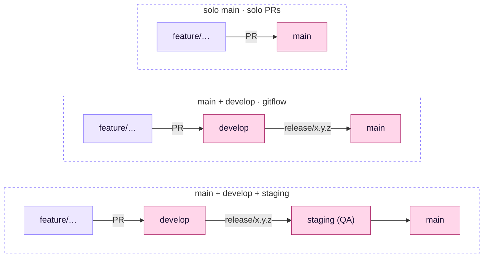

# ⚙️ Configuración del proyecto

[← Documentación](README.md)

seckert funciona sin configurar nada. Esta página explica qué detecta solo y qué puedes ajustar.

## 🌿 Ramas: se detectan solas

El plugin mira qué ramas existen en el repo y adapta el flujo:

| El repo tiene… | Flujo | Ramas de trabajo | Release | Hotfix |
|---|---|---|---|---|
| solo `main` | solo PRs | desde `main`, PR a `main` | versión por PR y release en GitHub | fix normal desde `main` |
| `main` + `develop` | gitflow | desde `develop`, PR a `develop` | `release/x.y.z` → `main` | `hotfix/*` desde `main` → `main` y `develop` |
| `main` + `develop` + `staging` | gitflow con staging | desde `develop`, PR a `develop` | `release/x.y.z` → `staging` (QA) → `main` | `hotfix/*` desde `main` → `main`, `staging` y `develop` |

- 🔒 Las ramas protegidas (en rosa) son las de esa lista que existan en el repo. Un hook bloquea los commits y pushes directos a ellas. Subir solo tags sí se puede.
- Si un proyecto agrega `staging` o `develop`, el flujo cambia solo en la siguiente sesión.
- También se reconocen `master`, `dev`/`development` y `stage`/`preprod`.

<b>Casos raros</b>

El `.claude/settings.json` del proyecto puede forzarlo con `env`: `SECKERT_STAGING_BRANCH` (nombre de la rama de staging) o `SECKERT_PROTECTED_BRANCHES` (lista de ramas protegidas). Si el `CLAUDE.md` o `AGENTS.md` del proyecto define otras reglas de ramas, mandan esas.

## 🧪 Tests según riesgo

Se elige por proyecto con una línea en su `CLAUDE.md` o `AGENTS.md`: `seckert tests: light | risk | strict`. Por defecto es `risk`.

| Tarea | `light` | `risk` ⭐ | `strict` |
|---|---|---|---|
| Bug | 🔴 test primero | 🔴 test primero | 🔴 test primero |
| Lógica sensible (dinero, permisos, datos) | 🟡 en el mismo cambio | 🔴 test primero | 🔴 test primero |
| Resto de lógica | ⚪ opcional | 🟡 en el mismo cambio | 🔴 test primero |
| Presentación / trivial | ⚪ sin test | ⚪ sin test (vs. artifact) | ⚪ sin test (vs. artifact) |

"Test primero" quiere decir que Claude escribe el test, lo ve fallar y recién después arregla. Mientras itera corre solo el test afectado; la suite completa, una vez antes del commit o del PR.

## 📄 AGENTS.md del proyecto

seckert funciona sin `AGENTS.md` ni `CLAUDE.md`, con sus valores por defecto. Si el proyecto tiene uno de los dos (o los dos), Claude Code los carga solo y sus reglas de tests, ramas y commits mandan sobre las de seckert. Ahí va lo que solo sabe el proyecto:

| Lo pone seckert | Va en el AGENTS.md |
|---|---|
| Cómo se planifica (fix directo, propuesta para lo grande) | Qué es sensible en este proyecto |
| Tests por riesgo, nivel por defecto | Runner, dónde viven los tests, excepciones |
| Ramas, base de los PRs, ramas protegidas | Formato de commits, método de merge, tags, despliegue |
| Diseño desde el artifact | Dónde están los tokens y el catálogo de componentes |
| Verificar en el navegador | Cómo levantar la app y la base aislada para verificar |
| Respuestas cortas, salidas recortadas | Comandos, estructura, convenciones, trampas |

Pídele a Claude "armá el AGENTS.md" o "ordená el AGENTS.md" y lo rellena con lo que encuentra en el repo, sin repetir lo que ya cubre seckert. El esqueleto está en [`skills/workflow/agents-template.md`](../skills/workflow/agents-template.md).

> [!TIP]
> Conviene que sea corto (60-150 líneas, porque se carga en cada sesión), con instrucciones concretas, sin secretos y sin nada que ya imponga una herramienta. En un monorepo, uno por subproyecto. Cuando Claude se equivoca dos veces en lo mismo, se agrega ahí.

## 📟 Barra, contexto vivo y ahorro de tokens

seckert trae un módulo (`hooks/register.tsx`) que corre dentro de Claude Code:

- **Barra encima del prompt** con el change activo, solo cuando hay uno abierto:
  `seckert csv-pedidos · 1/3 · sigue: T2 Filtro por fecha · feature/csv-pedidos`
- **Contexto vivo.** Cuando cambia un change (tarea marcada, aprobación, rama), Claude se entera junto con tu siguiente mensaje. Si nada cambió, no se manda nada.
- **Salidas recortadas.** Tests, builds, linters y typecheck de más de 80 líneas le llegan a Claude como fallos con contexto y el resumen final. Con `SECKERT_FULL=1` delante del comando llega entera.

Además, seckert le pide a Claude respuestas cortas, tests en modo silencioso y Grep para archivos enormes, y el verificador corre en Sonnet.

> [!NOTE]
> El módulo usa la API de plugins de función, en acceso anticipado: necesita una versión reciente de Claude Code. Con una versión anterior, el resto del plugin funciona igual.
