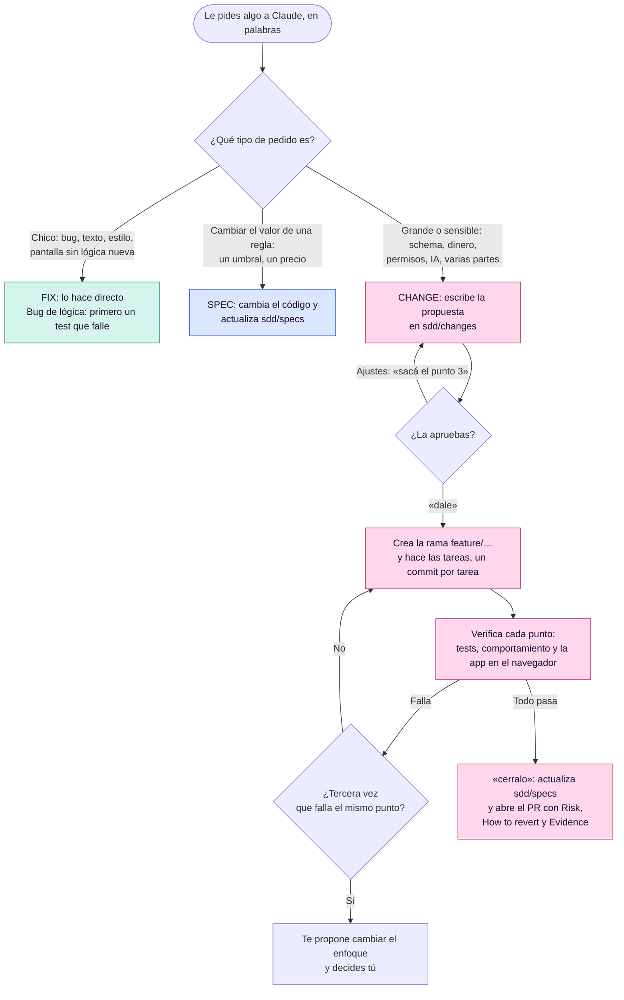
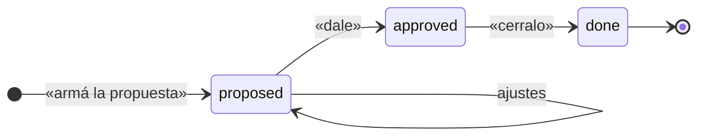

# 🗺️ Flujo de trabajo

[← Documentación](README.md)

## El mapa completo



## Las tres rutas

| Ruta | Cuándo | Papeles |
|---|---|---|
| 🟢 **FIX** | bug, texto, estilo, pantalla sin lógica nueva | ninguno |
| 🔵 **SPEC** | cambiar el valor de una regla que ya existe, aunque sea de dinero (un umbral, un precio) | actualiza `sdd/specs/` |
| 🟣 **CHANGE** | schema, lógica nueva de dinero o permisos, IA, o trabajo grande | `sdd/changes/…md` y tu aprobación |

Ante la duda, Claude elige FIX. Si el trabajo crece a más de ~8 archivos, para y te propone un CHANGE.

## Qué crea en el proyecto

```
sdd/
├── specs/<area>.md               cómo se comporta el sistema HOY (cada "## " es una regla)
└── changes/YYYY-MM-DD-<slug>.md  un archivo por cambio grande: Why, What, Tasks, Testing, Log
```

Los arreglos chicos no crean nada. Cada cambio grande vive en un solo archivo, y lo que decidiste queda en su Log.



## Planificar una feature

1. 💬 **Conversación libre.** Hablas con Claude sobre cómo encararla. Todavía no se crea nada.
2. 📝 **Borrador.** "armá la propuesta" crea `sdd/changes/<fecha>-<slug>.md` en `proposed`. La barra muestra `esperando tu "sí"` o cuántas preguntas abiertas quedan.
3. ✂️ **Ajustes.** Cada cosa que pidas ("sacá el punto 3", "partí T2") se aplica a ese mismo archivo. Las dudas van en `## Open questions` y se borran al responderlas. El porqué queda en el Log.
4. ✅ **Aprobación.** "dale" lo pasa a `approved`, crea la rama y empieza la primera tarea. Hasta entonces no se toca código.
5. 🚀 **Cierre.** Al terminar, Claude te ofrece verificarlo y cerrarlo con preguntas que respondes en palabras ("¿lo verifico?", "si está bien, lo cierro y abro el PR").

> [!TIP]
> Si el pedido es muy grande (más de ~8 tareas, o partes que sirven solas), Claude lo parte en varios changes en orden y escribe completo solo el primero. Lo que es solo presentación queda como un arreglo aparte. Si prefieres uno solo, díselo y los junta.

## Todo lo que puedes decir

| Dices algo como… | Claude hace |
|---|---|
| "Cambiá el texto del botón de pagar" | Lo cambia y te dice en dos líneas qué tocó |
| "Agregá exportación CSV de pedidos con filtro por fecha" | Si es grande, escribe la propuesta en `sdd/changes/` y espera tu "sí" |
| "Implementá esto: https://claude.ai/artifact/…" | Traduce el artifact a código con tus componentes y tokens |
| "sí" / "dale" / "adelante" | Aprueba la propuesta, crea `feature/<slug>` y empieza la primera tarea |
| "seguí" / "siguiente" / "hacé la T3" | Implementa la siguiente tarea y la commitea |
| "¿funciona?" / "verificá" | Verifica cada punto y lo visual contra el artifact y en el navegador |
| "cerralo" / "está ok, abrí el PR" | Cierra el change, actualiza `sdd/specs/` y abre el PR |
| "tomá el issue 12" | Crea la rama enlazada al issue aprobado y sigue su ruta: FIX, SPEC o CHANGE |
| "se rompió X en producción" | Rama desde `main`, un test que reproduce el fallo y el PR a `main` |
| "sacá la release 1.4.0" | Rama de release, versión, notas y PR según el flujo del repo |
| "¿en qué estamos?" / "¿qué falta?" | Resumen de los cambios abiertos |

Si prefieres los comandos, siguen disponibles: `/seckert:change`, `/seckert:design`, `/seckert:next`, `/seckert:verify`, `/seckert:done [pr]`, `/seckert:hotfix`, `/seckert:tomar`, `/seckert:release` y `/seckert:status`.
