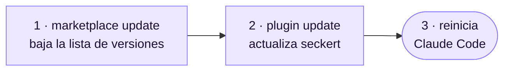

# 📦 Instalación

[← Documentación](README.md)

Necesitas Claude Code actualizado y acceso al repo privado [`abelcondev/seckert`](https://github.com/abelcondev/seckert) con tu usuario de GitHub. Es privado: solo entra quien tenga acceso al repo.

## Con un prompt (recomendado)

Abre Claude Code en cualquier carpeta y pega el prompt del [README](../README.md#-instalación). Comprueba el acceso, agrega el marketplace, instala (o actualiza) y te dice qué versión quedó.

## A mano

```sh
claude plugin marketplace add abelcondev/seckert
claude plugin install seckert@seckert
```

Después reinicia Claude Code. Para comprobar que quedó, corre `claude plugin list` y busca `seckert@seckert`, o pregúntale a Claude "¿en qué estamos?".

## Actualizar



```sh
claude plugin marketplace update seckert
claude plugin update seckert@seckert
```

Con solo el primer comando, el plugin se queda en la versión que tenías.

> [!NOTE]
> Si lo instalaste para un proyecto (scope `local` o `project`), corre `claude plugin update seckert@seckert` **dentro de la carpeta de ese proyecto**, y repítelo en cada proyecto donde lo tengas. `claude plugin list` muestra qué versión tienes en cada scope.
