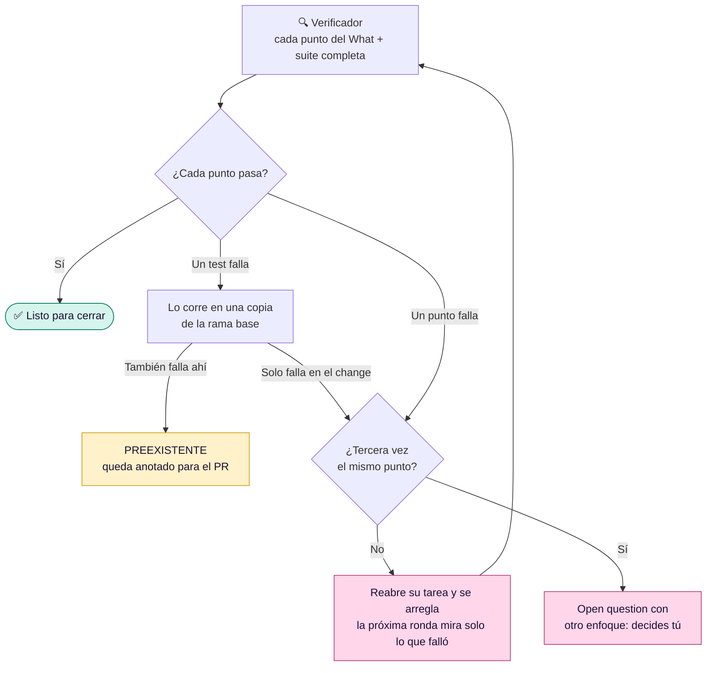

# ✅ Verificación y PR

[← Documentación](README.md)

Al terminar un change, Claude ofrece verificarlo. Un verificador aparte (`seckert-verifier`, en Sonnet) comprueba cada punto del What contra el comportamiento real, corre la suite y devuelve una tabla de veredictos que queda en el Log. La idea es que solo tengas que intervenir donde hace falta.

## Las rondas

- **Rondas que terminan.** En la siguiente verificación se mira solo lo que falló, más la suite completa por si se rompió otra cosa. Si el mismo punto falla por **tercera vez**, no se reabre más: queda en `## Open questions` con una propuesta para cambiar el enfoque.
- **El tipo de fallo, no solo el caso.** El verificador dice qué error es y en qué lugares del código aparece, para que el arreglo los cubra todos de una vez.
- **Fallos que no son del change.** La copia de la base es un `git worktree` temporal que se borra al terminar. Ante la duda (el change tocó dependencias o no se pudo comprobar en la base), cuenta como fallo del change.

## 🌐 En el navegador

Lo que solo se ve en la app (un texto, una pantalla, un flujo) Claude lo verifica con [Chrome DevTools MCP](https://github.com/ChromeDevTools/chrome-devtools-mcp). Abre una ventana para que veas el QA mientras se hace.

| Qué revisa | Cómo |
|---|---|
| 🚶 Cada punto del What | Lo recorre como un usuario, con datos solo de la base aislada del proyecto |
| 🧹 Consola y red | Cero errores y cero requests fallidos durante el flujo |
| 📱 Tres anchos | 375, 768 y 1280 px |
| ⏳ Estados | Vacío, cargando y error |
| ♿ Accesibilidad | Lighthouse: reporta los problemas, no el puntaje |

El resultado llega en texto, en la tabla de veredictos. No hay capturas que revisar.

<b>Si el MCP no está instalado</b>

Claude lo ofrece en una línea y sigue verificando lo que puede sin navegador. Si aceptas:

- Lo instala **en ese proyecto y solo para ti** (`claude mcp add --scope local`). No se escribe nada en el repo.
- Usa tu **Google Chrome** si lo tienes. Si no (o solo tienes Brave, Edge, Arc u otro Chromium, que el MCP no garantiza), baja **Chrome for Testing** a `~/.cache/seckert/chrome-for-testing`. No se instala en el sistema, no se actualiza solo, no cambia tu navegador por defecto y se reutiliza entre proyectos.
- Hay que reiniciar Claude Code para que cargue.
- Para quitarlo: `claude mcp remove chrome-devtools -s local` y borrar `~/.cache/seckert/chrome-for-testing`.

Si dices que no, seckert guarda la preferencia en el `.claude/settings.local.json` del proyecto (`"env": { "SECKERT_QA": "sin-navegador" }`) y no lo vuelve a ofrecer ahí. Ese archivo no se sube al repo y se mantiene cuando actualizas el plugin. Lo que solo se ve en la app queda `NO VERIFICABLE (sin navegador)` y lo miras tú. Para volver a activarlo, borra esa línea.

> [!NOTE]
> En proyectos **Expo**, lo visual se mira en el simulador (`xcrun simctl io booted screenshot`, o `adb` en Android). `expo start --web` con DevTools sirve para flujos y lógica, no como verificación visual.

## 🚀 El PR

Al cerrar, el PR que abre seckert le dice a quien revisa dónde mirar. Los títulos van siempre en inglés y el contenido en el idioma del proyecto. Además de Why, What y Testing, trae:

| Sección | Qué dice |
|---|---|
| ⚠️ `## Risk` | Las tareas sensibles (dinero, permisos, datos) y los archivos delicados que toca: migraciones, auth, pagos, workflows de CI, despliegue. Si no hay nada de eso, lo dice. |
| ↩️ `## How to revert` | Revertir el merge o apagar el flag. Con migración, si el código anterior funciona con el schema nuevo y qué datos se perderían al deshacerla. Nunca trae SQL ni comandos destructivos. |
| 🧾 `## Evidence` | La tabla de la última verificación y los fallos `PREEXISTENTE`. |

La idea viene de [cómo revisa código el equipo de Claude Code](https://claude.dev/blog/solving-code-review-at-anthropic/): tope de rondas, hallazgos que ya existían marcados aparte y un PR con riesgo y cómo revertir.
