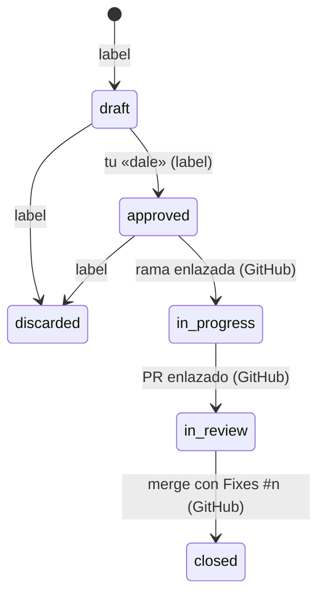

# Issues en un tracker desde el MCP

## Why

Parte 1 de 3. seckert es la continuación personal de seckert: un hub que lleva lo hablado con un cliente hasta un PR mergeado. La base es que Claude pueda crear, leer y mover issues en un tracker con un formato fijo, igual que hoy escribe changes. Se elige GitHub Issues como primer destino: es gratis, vive junto al código y `Fixes #n` en el PR cierra el issue al mergear.

## What

- Un issue canónico: título, contexto (de dónde sale, con cita textual), criterios de aceptación, ruta sugerida (FIX, SPEC o CHANGE) y origen (reunión, fecha, cliente).
- Estados del issue: `draft` → `approved` → `in-progress` → `in-review` → `closed`, o `discarded`. Solo el triage es label propia (`seckert:draft`, `seckert:approved`, `seckert:discarded`); `in-progress`, `in-review` y `closed` se leen de GitHub: rama enlazada al issue, PR enlazado abierto e issue cerrado. La transición la hace siempre la herramienta, nunca Claude a mano.
- Herramientas del MCP: `issue_create`, `issue_get`, `issue_list` (por estado) e `issue_transition`, sobre GitHub Issues vía `gh`.
- Los issues van al repo de GitHub del remoto `origin`; sin config.
- Pasar a `approved` exige las palabras del usuario, igual que aprobar un change.

## Diagram

## Open questions

## Tasks

- [x] T1 [datos] `lib/issue.ts`: issue canónico, render a markdown y parseo de vuelta, estados y transiciones válidas, con tests <!-- commit: a631bb7 -->
- [x] T2 [datos] `lib/trackers/github.ts`: adaptador sobre `gh` (crear, leer, listar por label, cambiar label), con tests sobre un `gh` simulado <!-- commit: 54e169c -->
- [x] T3 MCP: `issue_create`, `issue_get`, `issue_list`, `issue_transition`, con tests en `mcp/` <!-- commit: e1131e2 -->
- [x] T4 Descubrir el repo de GitHub desde `origin`, con tests <!-- commit: e1131e2 -->
- [x] T5 Spec `sdd/specs/issues.md` y skill `status` que muestre los issues por estado <!-- commit: 176368f -->
- [x] T6 [datos] Labels propias solo para el triage; `in-progress`, `in-review` y `closed` se leen de GitHub (rama enlazada, PR enlazado, issue cerrado). Ajusta `lib/issue.ts` y `lib/trackers/github.ts`, con tests <!-- commit: e26438b -->

## Testing

- Runner: bun run test
- Nivel: risk
- Lógica: Tests primero en lib/ y mcp/ para el modelo y los adaptadores (con el tracker simulado)
- Presentación: No aplica

## Log

- **L1** (pedido original, verbatim): quiero crear encima de esto una capa que cree issues en linear o en github issues (evalua ambos y otras alternativas) porque quiero crear todo un hub de desarrollo, desde que hay una reu con el cliente, con una AI tomando notas, que esas notas se conviertan en issues y que esos issues pasen por claude code y por mi filtro y que termine en una pr y merge
- **L2** P1: el plugin pasa a llamarse seckert y la licencia a uso personal; hecho en el PR #1 ("p1 sí, renombra y cambia la licencia, dale")
- 2026-11-06: aprobado ("dale"). Rama feature/issues-tracker desde main.
- 2026-11-06: T1 hecha (a631bb7). tests/issue.test.ts (7 tests) falló primero (no cargaba) y pasa con lib/issue.ts: cuerpo con secciones fijas ida y vuelta, label seckert:<estado>, transiciones y aprobar con palabras; bun run test sin fallos.
- 2026-11-06: T2 hecha (54e169c). tests/github.test.ts (7 tests) falló primero (no cargaba) y pasa con lib/trackers/github.ts y la interfaz Tracker: crear con label y cuerpo por stdin, leer, cerrado tras un merge con Fixes #n, listar por estado, mover label, cerrar al pasar a cerrado o descartado; bun run test sin fallos (MCP 42, módulo 64).
- **L3** Solo GitHub, sin Linear ("vamos a ir a usar solo github ya no linear"); menos labels propias para no desincronizar con lo que GitHub ya muestra (ajuste aceptado tras la búsqueda: "ok me parece"). Se quita la parte tracker-linear.
- **L4** Estados y labels en inglés (draft, approved, in-progress, in-review, closed, discarded): "que los labels sean en ingles".
- 2026-11-06: T6 hecha (e26438b). Tests nuevos de estados derivados y del adaptador fallaron primero (7 fallos + 1 sin cargar) y pasan: labels solo seckert:draft|approved|discarded; in-progress por rama enlazada (gh issue develop --list), in-review por PR enlazado abierto, closed/discarded por stateReason; escribir un estado de GitHub se rechaza; bun run test sin fallos (MCP 42, módulo 68).
- 2026-11-06: T3 hecha (e1131e2). mcp/issues.spec.ts contra el servidor compilado y un gh falso en el PATH: 7 de 9 fallaron primero (sin herramientas) y pasan; crea en draft, aprobar sin palabras falla y con palabras deja comentario, descartar cierra como no planeado, in-progress/in-review leídos de rama y PR, list filtra, error de gh visible; bun run test sin fallos (MCP 51, módulo 68).
- 2026-11-06: T4 hecha (e1131e2). parseRemote saca owner/repo de origin por ssh y https y rechaza otros hosts (test en mcp/issues.spec.ts); issue_create con origin git@github.com:acme/tienda.git llama a gh con --repo acme/tienda; va en el mismo commit que T3 porque las herramientas lo necesitan.
- 2026-11-06: T5 hecha (176368f). sdd/specs/issues.md con 4 reglas (Dónde viven, Formato, Estados, Triage) escritas con spec_write; skill status suma issue_list agrupado por estado y workflow nombra las herramientas de issues; claude plugin validate ok y bun run test sin fallos (MCP 51, módulo 68).
- **L5** 2026-11-07: prueba en GitHub real (abelcondev/seckert, "dale, probalo en github real"): issue #3 creado en draft con el cuerpo de seckert; aprobar sin palabras falló y con palabras dejó seckert:approved y el comentario; rama enlazada con gh issue develop → in-progress; PR borrador #4 con Fixes #3 → in-review; descartar → CLOSED/NOT_PLANNED, discarded. Sin probar en real: closed por merge (no se mergeó a main). Limpieza: PR #4 cerrado, rama borrada, issue #3 borrado; quedan las 3 labels seckert:*.
- 2026-11-07 verify: PASA "Un issue canónico: título, contexto (de dónde sale, con cita textual), criterios de aceptación, ruta sugerida (FIX, SPEC o CHANGE) y origen (reunión, fecha, cliente)"; PASA "Estados del issue: `draft` → `approved` → `in-progress` → `in-review` → `closed`, o `discarded`. Solo el triage es label propia (`seckert:draft`, `seckert:approved`, `seckert:discarded`); `in-progress`, `in-review` y `closed` se leen de GitHub: rama enlazada al issue, PR enlazado abierto e issue cerrado. La transición la hace siempre la herramienta, nunca Claude a mano"; PASA "Herramientas del MCP: `issue_create`, `issue_get`, `issue_list` (por estado) e `issue_transition`, sobre GitHub Issues vía `gh`"; PASA "Los issues van al repo de GitHub del remoto `origin`; sin config"; PASA "Pasar a `approved` exige las palabras del usuario, igual que aprobar un change". Comandos: `bun run test (MCP 51, módulo 68, shell sin fallos)`.
- 2026-11-07: cerrado ("dale, verificalo y abrí el PR").
