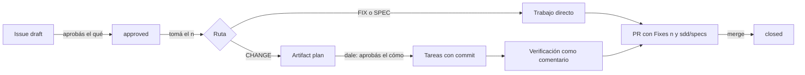

# El issue es el change

## Why

Parte 2 de 4: después de `issue-template-v2`. Hoy un cambio se escribe dos veces: en el issue y en `sdd/changes`. El usuario quiere menos SDD y más peso en los issues: «no me importaria reducir el sdd o que los issues tengan mas relevancia».

## What

- Con GitHub Issues, el issue es el change. El body dice qué y por qué (template v2) y lo escribe el usuario o Claude al crearlo.
- El plan de un CHANGE es un issue artifact de tipo `plan`, con las tareas como casillas y su commit, el diagrama y cómo se testea. Cada cambio del plan queda como versión.
- El diseño es un issue artifact de tipo `link` llamado «Diseño». `tomar` y la traducción del diseño lo leen de ahí, y la verificación visual lo compara.
- Las aprobaciones, las respuestas a preguntas y la verificación quedan como comentarios del issue.
- Aprobar el issue decide si se hace y qué. El «dale» del plan decide cómo, y solo existe en un CHANGE.
- Las herramientas no cambian de forma: `change_get`, `change_update`, `task_complete`, `verify_record` y `pr_draft` leen y escriben en el issue cuando el change tiene uno.
- `sdd/specs/` se actualiza en el mismo PR. No queda archivo en `sdd/changes/`: el historial son los issues y PRs cerrados.
- Si los artifacts no están disponibles (son una preview), el plan va en una sección `## Plan` del body. Sin GitHub Issues, `sdd/changes/` sigue funcionando como hoy.
- Un pedido de trabajo dicho en lenguaje natural va directo a GitHub, sin decir «creá un issue». Por ejemplo, «vamos a agregar un botón para descargar un CSV de la lista de pedidos» crea el issue. Las preguntas, explicaciones y exploraciones no crean issues.
- Si el pedido viene del usuario y no tiene Open questions, el issue nace `approved` con sus palabras como aprobación, y Claude lo toma: un FIX se hace directo y termina en PR, un CHANGE adjunta el plan y espera el «dale». Con «para después» o «anótalo», solo se crea.
- Lo que todavía no está claro se discute en la sesión, sin issue. Cuando la conversación llega a algo concreto, Claude ofrece en una línea pasarlo a issue, con lo decidido en `## Decisions`.
- El modo issues se activa con la línea `seckert issues: github` en el AGENTS.md del proyecto. Sin esa línea, seckert trabaja como hoy, con `sdd/changes/`, aunque el repo esté en GitHub.

## Diagram

## Open questions

## Tasks

- [x] T1 [datos] El change leído desde el issue: el qué desde el body v2 y el plan desde el artifact `plan`, con fallback a `## Plan` (tests primero) <!-- commit: 000822b -->
- [x] T2 Issue artifacts por la API REST (`gh api`): crear, leer y actualizar `plan` y `link` <!-- commit: 7c26d09 -->
- [x] T3 `change_get`, `change_update` y `task_complete` sobre el issue: tareas como casillas con su commit, y una versión del plan por cambio <!-- commit: a88d465 -->
- [x] T4 Aprobación del plan y `verify_record` como comentarios, con la reapertura de tareas en el plan <!-- commit: 628a800 -->
- [x] T5 Diseño como artifact `link`: al crear el issue con un link de diseño, al tomarlo y en la verificación visual <!-- commit: ea8c0ed -->
- [x] T6 `pr_draft` y cierre desde el issue: Why y What del body, specs en el mismo PR, sin archivo en `sdd/changes/` <!-- commit: 3f4086a -->
- [x] T7 Skills `tomar`, `next`, `verify` y `done` sobre el issue; modo local sin cambios <!-- commit: fdf4530 -->
- [x] T8 Evals: un CHANGE con diseño de punta a punta, y el fallback sin artifacts <!-- commit: 0185e54 -->
- [x] T9 Pedidos en lenguaje natural a issue: reglas del contexto de inicio y de `seckert:workflow` con `seckert issues: github`, y la oferta de pasar a issue al cerrar una discusión <!-- commit: b0b48f7 -->
- [x] T10 Evals: un pedido natural crea el issue aprobado y termina en PR; una pregunta exploratoria no crea issue; sin la línea en AGENTS.md todo sigue como hoy <!-- commit: b1c64f0 -->

## Testing

- Runner: bun run test
- Nivel: risk
- Lógica: Tests primero en mcp/ con el gh falso extendido a artifacts y comentarios; el modo archivo con sus tests actuales
- Presentación: No aplica

## Log

- **L1** (pedido original, verbatim): ahora me surge una duda: nosotros en sdd tenemos por ejemplo un change que tiene sus todos internas o un spec. no seria como duplicar el trabajo cuando usemos gh issues? como podriamos hacer un flujo mas eficiente entre issue y sdd. Nota: no me importaria reducir el sdd o que los issues tengan mas relevancia, ahi evalua como funcionaria mejor
[...]
en caso de features grandes que tengan artifact como seria? veo aqui que se puede adjuntar en gh issues
[...]
dale, ajustá las propuestas y sumalo a la página
- **L2** P1: Los changes `done` quedan en `sdd/changes/` como historial, sin migrar. El usuario: «ok me parece bien».
- **L3** P2: Sí, y más amplio: todo pedido de trabajo va a GitHub. El usuario: «cualquier pedido relacionado al flujo de issues deberia ir a gh, es decir: si digo cosas como: vamos a agregar un boton para descargar un csv de x pantalla. Eso deberia conectarse a gh directamente, en vez de decir: crea un issue: vamos a agregar un boton…».
- 2026-11-08: aprobado ("mergea, y segui"). Rama feature/issue-como-change desde main.
- 2026-11-08: T1 hecha (000822b). bun run test exit 0; tests/issue-change.test.ts 7/7: el change se arma desde issue y plan, planFromChange devuelve el plan original con commit visible, un change nuevo queda sin Why/What, criterios y líneas nuevas del Log, y el fallback ## Plan en el body se lee igual sin romper parseBody
- 2026-11-08: T2 hecha (7c26d09). bun run test exit 0; github.test: list con ?type=plan, POST y PATCH con --input y X-GitHub-Api-Version 2026-03-10; un 404 lanza ArtifactsUnavailable; el gh falso crea, lista y versiona artifacts
- 2026-11-08: T3 hecha (a88d465). bun run test exit 0; mcp/issue-change.spec.ts 5/5: change_create con issue crea el artifact Plan y la label seckert:change sin archivo; change_get arma What desde los criterios; aprobar, task_complete y what_add escriben plan (3 versiones), casilla con commit visible, comentarios y criterios del body; fallback ## Plan; sin la línea en AGENTS.md sigue en archivo
- 2026-11-08: T4 hecha (628a800). bun run test exit 0; issue-change.spec: la aprobación queda como comentario con «dale»; verify_record con un FALLA reabre T1 en el plan y comenta una tabla con cada punto, veredicto, detalle, comandos y T1 reabierta
- 2026-11-08: T5 hecha (ea8c0ed). bun run test exit 0; issue-change.spec: issue_create con design crea el artifact link Design con la URL, issue_get la devuelve y change_get la expone como design; sin artifacts va a References como «Design: url» y se lee igual
- 2026-11-08: T6 hecha (3f4086a). bun run test exit 0; issue-change.spec: pr_draft del change en su issue empieza con Fixes #1, Why con Problem y Outcome, What con los criterios y sin Tasks; change_transition done deja status: done en el plan, comenta el cierre y no crea sdd/changes. Pasó sin código nuevo: sale de T3
- 2026-11-08: T7 hecha (fdf4530). bun run test exit 0; live.test: la barra muestra un change leído de .git/seckert/changes; issue-change.spec: change_get da path .git/seckert/changes/<slug>.md con el change completo y --context lo lista sin ninguna llamada a gh; skills tomar, verify, done y el verificador actualizados
- 2026-11-08: T9 hecha (b0b48f7). bun run test exit 0; tests/session-context.sh 5/5: con la línea en AGENTS.md o CLAUDE.md aparecen las reglas del modo issues, sin ella no; live.test: en modo issues el contexto vivo dice que los pedidos nuevos van a un issue y no que se hacen directo
- 2026-11-08: T8 hecha (0185e54). claude plugin eval: issue-change-diseno 3/3 (tras corregir que issue_take no devolvía el diseño) e issue-change-sin-artifacts 3/3; bun run test exit 0
- 2026-11-08: T10 hecha (b1c64f0). claude plugin eval: pedido-natural 3/3 (crea, aprueba con las palabras del usuario, toma y hace el FIX), pregunta-sin-issue 3/3 (sin issue_create) y el control fix-texto-boton 3/3 sin la línea en AGENTS.md
